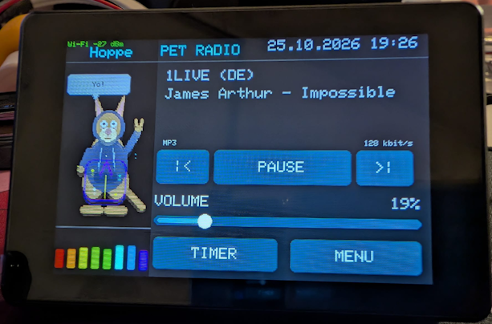

# CYD PET Radio

> **AI disclosure:** The text of this README was created with AI assistance.

A touchscreen webradio for the ESP32-based CYD (Cheap Yellow Display), the
Freenove FNK0114L, the Guition JC3248W535C_I_Y, and the Freenove FNK0104B, using the same basic board configuration as
[CYD of the Dead](https://github.com/tsm-source/CYD-of-the-dead). A round,
animated cat dances in the left 30% of the display while radio controls fill
the right side. Both panels are rendered into 8-bit sprite buffers before
being transferred to the display to prevent partial-frame flicker. The lower
left panel shows a pulsing eight-band FFT spectrum from bass to treble, based
on the decoded audio samples.



## Hardware configuration

The firmware supports the CYD and Freenove boards, including two CYD display
variants, plus the Guition JC3248W535C_I_Y. Choose the matching firmware in PlatformIO or the web flasher; the
display controllers and some board-specific pin configurations differ, so
the firmware images are not interchangeable.

| Feature | CYD 2.8″ ST7789 | CYD 2.8″ ILI9341 (ESP32-2432S028R) | Freenove FNK0114L 3.2″ | JC3248W535C_I_Y 3.5″ |
|---------|----------------|-----------------------------------|------------------------|----------------------|
| Display | ST7789, 240 × 320 | ILI9341, 240 × 320 | ST7789, 240 × 320 | AXS15231B QSPI, 320 × 480 (landscape UI) |
| Touch | Resistive XPT2046, dedicated SPI bus | Resistive XPT2046, dedicated SPI bus | Resistive XPT2046, shared HSPI bus | Capacitive AXS15231B, I²C |
| Audio output | Built-in DAC, GPIO 26 | Built-in DAC, GPIO 26 | Built-in DAC, GPIO 26 | On-board I²S output (BCLK 42, LRCLK 2, DOUT 41) |
| Backlight | GPIO 21 | GPIO 21 | GPIO 27 | GPIO 1 |
| PlatformIO environment | `esp32dev` (40 MHz), `esp32dev-fast` (80 MHz), or `esp32dev-fast-low-memory` for HTTPS on boards without PSRAM | `esp32dev-ili9341` (40 MHz) or `esp32dev-ili9341-low-memory` for HTTPS on boards without PSRAM | `fnk0114l` (80 MHz) or `fnk0114l-low-memory` for HTTPS | `jc3248w535` |
| Display setup | `include/cyd_user_setup.h` | `include/cyd_ili9341_setup.h` | `include/freenove_fnk0114l_setup.h` | `include/jc3248w535_display.h` |

The CYD and FNK0114L use the ESP32's built-in DAC on GPIO 26 for mono speaker
output. The JC3248W535C_I_Y uses its on-board I²S audio path. Wi-Fi credentials
and the station list are saved in each board's non-volatile storage.

### Freenove FNK0104B 2.8″ (ESP32-S3)

Environment `fnk0104b`, display setup `include/freenove_fnk0104b_setup.h`.
ILI9341 240 × 320 over SPI (MOSI 11, SCLK 12, MISO 13, CS 10, DC 46,
backlight 45), capacitive FT6336U touch over I²C (SDA 16, SCL 15, reset 18) and
audio through the ES8311 codec (MCLK 4, BCLK 5, LRCLK 7, DOUT 8, amplifier
enable GPIO 1). The codec sample rate follows the stream. The CYD-only
GPIO 4 amplifier and noise-shaping options are not shown on this board.

The FNK0114L also has an optional rear RGB LED. Open **MENU > RGB LED** to
enable it, choose one of five colors, and optionally turn on slow pulsing.
These controls are available only in the FNK0114L firmware; the CYD's rear LED
hardware and pin assignments are not confirmed as compatible.

The `esp32dev-fast` environment uses an 80 MHz SPI clock and may be unstable
on some CYD boards. Use `esp32dev` if the ST7789 display shows artifacts.
The low-memory environments render the home-screen animation and spectrum into
a small 8-bit panel sprite instead of allocating a full-screen sprite. The pet
name is shown as a static header, separated from the animation by a continuous
line. Animation drawing is clipped between that header and the spectrum; the
complete panel is pushed as one frame to reduce flicker. This frees internal
heap for HTTPS/TLS; the audio input buffer is unchanged.
At boot, the serial log reports the detected display setup and the active
PlatformIO profile to help identify firmware/display mismatches. While running,
a status line (`[board] wifi=… stream=… codec=… bitrate=…`) is printed every
five seconds.

Known limitation: some ESP32-2432S028 boards with both a USB-C and a micro USB
port have a speaker amplifier stage that is very loud and noisy with this
firmware, even at the lowest volume step. The cause appears to be the board's
hardware; the firmware's output level, noise shaping, compressor, and Wi-Fi
settings do not remove it. Use the headphone jack or another board for audio.

## Testing before a release

Every board profile must be built and checked on hardware before tagging a
release. `scripts/dual_monitor.py` reads several boards at once and prefixes
each line with a board name, without resetting them:

```sh
python scripts/dual_monitor.py 40 ST7789=COM9 JC3248=COM10
```

Checklist per board: Wi-Fi connects, a stream starts (`stream=on`, codec and
bitrate shown), audio is audible, station change works, display and touch
work, and the timer alarm sounds. Common code paths such as
`radioAudio.loop()` must be serviced on every board.

## Radio controls

On first boot, touch the five calibration targets that appear. The firmware
fits an affine touch mapping to all five measurements to compensate for axis
skew and rotation. To repeat calibration later, open **MENU > DISPLAY & TOUCH**
and tap **RECALIBRATE TOUCHSCREEN**.
Open **MENU > WI-FI** to enter the Wi-Fi network name and password with the
touchscreen keyboard, then tap **CONNECT**. The radio starts its selected
station once Wi-Fi connects.
The home screen provides station navigation, play/pause, and a touchscreen
volume slider. The top-right corner shows the current Europe/Berlin time and
date. Wi-Fi status and signal strength appear to the left of the **PET RADIO**
heading. Station name and stream title appear below the heading, with bitrate
under the title. The detected codec (such as MP3 or AAC) appears to the left of
the bitrate. Long stream titles wrap onto a second line before the codec and
bitrate.
The clock synchronizes over the internet using NTP; until synchronization, it
shows placeholder dashes.

Tap **TIMER** in the upper-right corner to replace the pet animation with a
countdown. Set time in one-minute and ten-second steps, then tap **START**.
**STOP** pauses the countdown; **START** resumes it. Music stops five seconds
before the timer ends, when a quiet chime plays at a level proportional to the
configured music volume. The timer remains visible for one minute after it
expires with a pulsing orange **Time is up** display. Tap that display or
**TIMER** to end the timer, stop the chime, and resume the music that the timer
stopped; **STOP** also confirms the end and restores the pets. Tapping **TIMER**
before expiry cancels the countdown and restores the pets immediately.
On the FNK0114L, the rear RGB LED (when enabled in the RGB LED settings) pulses
faster as the timer approaches zero. The CYD has no confirmed compatible rear
RGB LED, so timer lighting is disabled there.

Choose one of ten dark background colors in **MENU > DISPLAY & TOUCH**. The
selection is saved across restarts, and interface text remains white for
readability. The **BUTTONS** swatches on the same page independently choose
the button fill from ten muted accent colors. These dark colors keep white
labels readable on both supported displays. The choice applies to play/pause
and all toggle buttons, regardless of whether a toggle is on or off, and is
saved across restarts. The volume slider track uses the selected button color
as well.

Enable optional dynamic audio compression in **MENU > AUDIO** to boost quieter
audio while controlling loud peaks. This can make streaming volume more
consistent, but does not increase the CYD's physical amplifier output.

If playback is too quiet at 100%, open **MENU > AUDIO** and enable **AUDIO
BOOST +6 dB**. This applies digital equalizer gain and is saved across
restarts. Boost can cause distortion on loud audio; switch it off if playback
clips. The regular volume control still sets the decoder level independently.

The **GPIO4 AMP** option in **MENU > AUDIO** defaults to off. When enabled, it
drives GPIO 4 low; when disabled, it drives GPIO 4 high. Use this only with a
CYD board revision whose speaker-amplifier enable is wired to GPIO 4, since
pin assignments can differ between board revisions.

The built-in DAC has only 8 bits, which causes audible hiss. Enable **NOISE
SHAPING** in **MENU > AUDIO** to shift the quantization noise to higher
frequencies where it is less audible. At each stream start, audio stays muted
until the first non-silent decoded sample, remains muted for one second, and
then fades in over 750 ms to reduce clicks when switching stations.

The Wi-Fi connection scans every 2.4 GHz channel and reports whether the SSID
was not found or WPA2 authentication failed. If the connection still fails,
open the PlatformIO serial monitor at 115200 baud; diagnostic output includes
the Wi-Fi disconnect reason without printing the password. WPA2 Personal
passphrases must contain 8–63 characters. If the connection stays down for 30
seconds, the radio automatically reconnects and restarts the stream, and keeps
retrying every 30 seconds until Wi-Fi is available again.

Open **STATIONS** or **MENU > STATIONS** to play a station, edit its name or
stream URL, add a station, or remove one. The list is paginated and supports up
to 20 stations. On a fresh setup, `src/playlist.csv` supplies the default
playlist at build time. It is tab-separated with station name and HTTP(S)
stream URL in the first two columns; later columns are ignored. The build
validates field sizes and URL format. Currently unreachable stations should be
removed or updated in the CSV before building.

The default list has 15 German-language stations, including the compatible
entries from the provided list: Hit Radio FFH, Bayern 3, Sunshine Live, Absolut
Radio Germany, N-JOY, bigFM, Radio BOB!, Klassik Radio, RPR1, STAR FM Berlin,
and MDR JUMP. WDR 2 and SWR3 use updated stream URLs. English-language
stations are omitted to reduce firmware memory use. BBC is also omitted
because its available streams use HLS, which has not been verified on the
target boards. KISS, Virgin Radio, and talkSPORT were not added because a
stable compatible direct stream could not be confirmed.
Freshly flashed devices get this playlist; existing personalized lists are
preserved. Known factory entries from the previous English-language list are
removed, and unchanged German factory URLs are updated. The previous built-in
three-station default is also migrated to the new list. Direct MP3 and AAC
streams are used; HLS or other playlists may not be reliable on all boards.

## Pets


The slideshow above shows all eleven pets. Every pet except Moritz and Blitz
has two looks that the radio picks by dance: Willi hangs from a branch or sits
and waves in a rasta cap, Egon has animated spots or headphones with neon
stripes, Hoppe wears a hoodie or headphones with a boombox, Siegfried plays a
flying-V guitar or throws devil horns, Leopold is a singer with a microphone
or a king with a crown and sceptre, Ludwig conducts in a top hat or plays the
violin in a baroque wig, Poldi shows a full fan or plays the rock star, and
Hansi wears a glitter jacket or folk costume. It is
rendered from the drawing code by `scripts/render_pets.py` (requires Pillow)
and shows the pets without outfits; the device display looks slightly
different.

| Pet | Animal |
|-----|--------|
| Claudia | Cat |
| Poldi | Peacock |
| Leopold | Lion |
| Hoppe | Kangaroo |
| Egon | Chameleon |
| Ludwig | Swan |
| Moritz | Cat |
| Siegfried | Rhino |
| Willi | Sloth |
| Blitz | Horse |
| Hansi | Budgie |

Claudia is shown first. The pets then change to a different random pet every
30 seconds; tapping the pet panel advances to another pet immediately. Each
pet's name appears above the animation, and the illustrated animals also show
their animal type below it. Each pet displays a random English quip in a
speech bubble.
Each bubble stays visible for 2 seconds, with a randomized 5-to-15-second
interval between appearances.
Pets use three randomly selected dance animations that change during playback.
When the displayed pet changes, the previous one runs out and the next runs in.
All pets blink briefly at staggered intervals independently of their dance
poses.
Each appearance also gets a randomly selected outfit: a tie, sunglasses, boots,
or a glitter jacket.
The 8-band audio spectrum adapts automatically to the volume and compensates
the natural treble roll-off of music so all bars use the available height. It
updates four times per second to reduce processing load and can be switched on or off by tapping the spectrum in the lower-left
corner or through the settings menu; the selection is saved.
To leave more internal RAM for MP3 decoding, the pet is drawn directly into the
full-screen frame buffer instead of a second sprite; the decoder uses its
default input-buffer size. If a stream reports end-of-file, the radio retries
it after a short delay. Date and time are shown in compact `DD.MM HH:MM` format;
NTP synchronization is also requested after Wi-Fi connects.

The audio decoder is pinned to
[ESP32-audioI2S 2.0.6](https://github.com/schreibfaul1/ESP32-audioI2S/tree/2.0.6)
because this release supports the classic ESP32's built-in DAC used by the
CYD/FNK0114L and I²S output used by the JC3248W535C_I_Y and FNK0104B. The decoder
is licensed under GPL-3.0; check its license and the requirements that apply
when distributing firmware.

The radio playback flow and stream-metadata handling take inspiration from
[yoRadio](https://github.com/e2002/yoradio); the touchscreen interface,
settings, and cat animation are implemented for this CYD project.

## Install from a browser

After enabling GitHub Pages for this repository with **Settings > Pages >
Build and deployment > GitHub Actions**, choose the matching board button on
the [web flasher](https://tsm-source.github.io/CYD-PET-Radio/). Every push to
`main` builds the five firmware variants and deploys the flasher
automatically. The CYD and Freenove options use low-memory builds, which
reserve more internal heap for HTTPS/TLS streams. The JC3248W535C_I_Y profile
renders the landscape interface at the panel's native 480 × 320 pixel
resolution, uses PSRAM-backed frame and stream buffers, and updates only the
display region that changed.

Use a desktop browser that supports Web Serial, such as Chrome or Edge, and a
USB data cable. If the flasher offers to erase the device, erasing also
removes the saved Wi-Fi credentials, station list, volume, and touchscreen
calibration.

## Build and upload

Install Visual Studio Code with the PlatformIO IDE extension, then open this
project folder. Connect the board over USB and build or upload with PlatformIO,
or run:

```sh
pio run -e esp32dev-fast
pio run -e esp32dev-fast -t upload
pio run -e esp32dev-fast-low-memory
pio run -e esp32dev-fast-low-memory -t upload
pio run -e esp32dev-ili9341
pio run -e esp32dev-ili9341 -t upload
pio run -e fnk0114l
pio run -e fnk0114l -t upload
pio run -e fnk0114l-low-memory
pio run -e fnk0114l-low-memory -t upload
pio run -e jc3248w535
pio run -e jc3248w535 -t upload --upload-port COM10
pio run -e fnk0104b
pio run -e fnk0104b -t upload
```

The volume, Wi-Fi credentials, touchscreen calibration, and station list are
stored on each board and persist across reboots.
